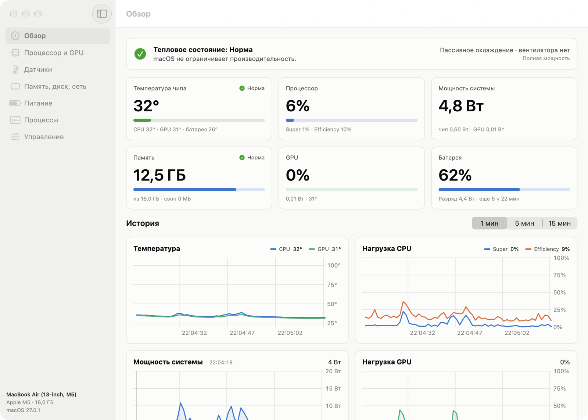
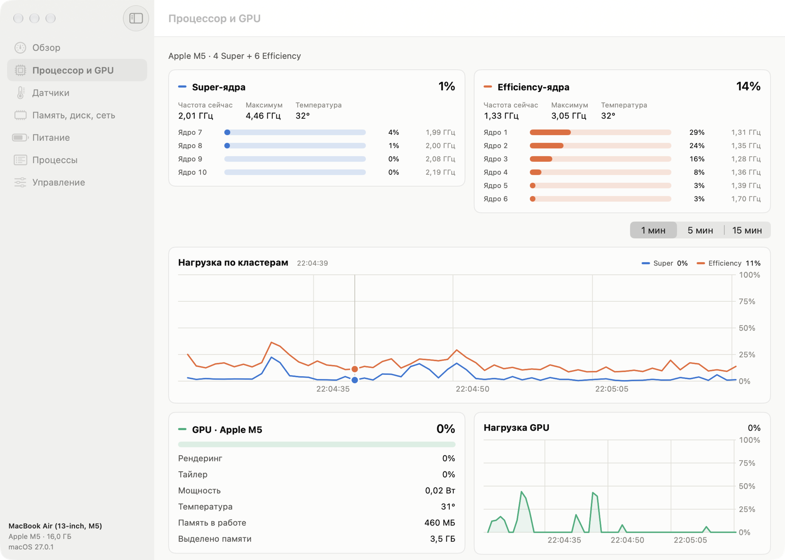
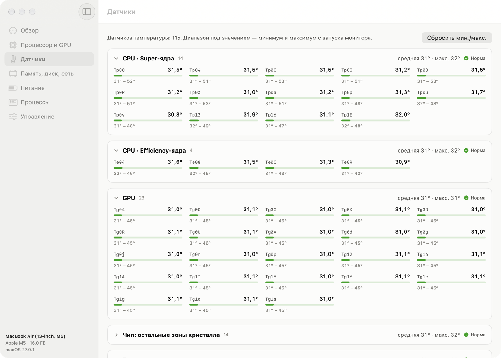
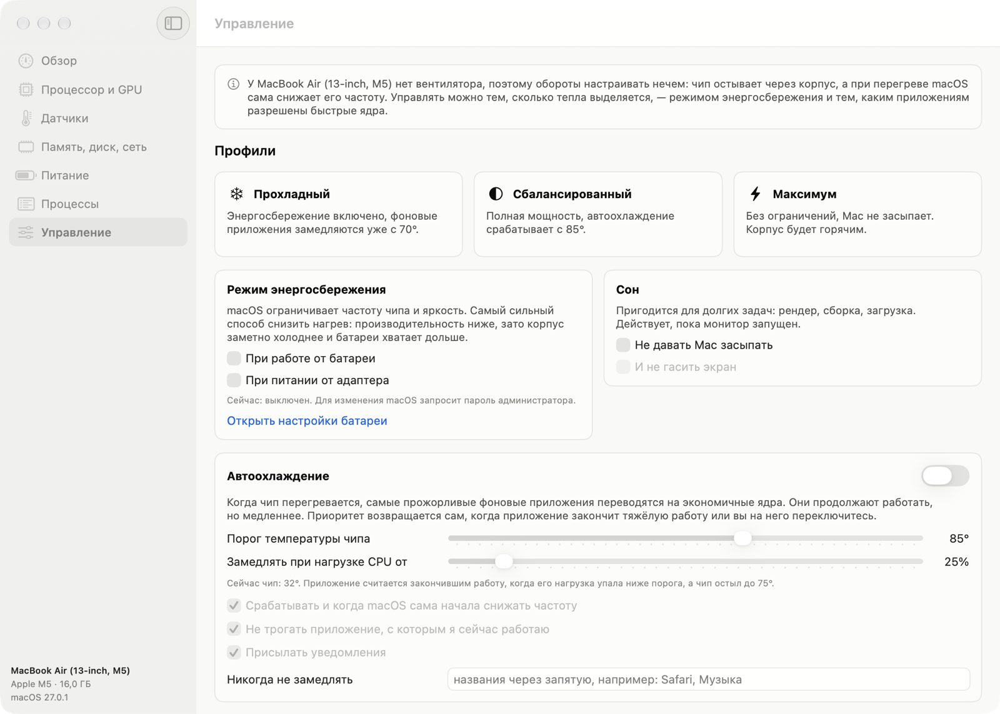

# HWMonitor

A hardware monitor for Apple Silicon Macs: temperatures, per-core frequencies and load, GPU, memory, disk, network, battery and power draw — plus heat management. No root, no Xcode, no third-party dependencies.



> The app's interface is in Russian and English (can be switched in settings).

## Features

- **Temperatures** — every live SMC sensor (115 on an M5), grouped into Super and Efficiency cores, GPU, battery, SSD, Wi‑Fi, power controllers and more, with min/max since launch.
- **CPU** — load and current frequency of every core, average cluster frequency, history.
- **GPU, memory, disk, network** — GPU load and power, memory breakdown and pressure, swap, free space, disk throughput and traffic.
- **Power** — system and chip power in watts; battery charge, health and cycle count; charger.
- **Thermal state** — the macOS thermal pressure level, so you can see when the system starts throttling.
- **Processes** — CPU, memory, power draw and share of time on performance cores, grouped by app. Your own apps can be slowed down, paused or quit.
- **Auto-cooling** — when the chip overheats, the heaviest background apps are moved to efficiency cores (see below).
- **Low Power Mode** for battery and charger, keep-awake, three presets.
- **Menu bar** — temperature and load, with a summary on click. Close the window and the monitor keeps running.

| | |
|---|---|
|  |  |

## How "cooling" works on a fanless Mac

A MacBook Air has no fan, so there is no fan speed to tune: the chip cools through the chassis, and macOS lowers its clock when it gets too hot. The only thing you can control is how much heat is produced.

The main lever is background priority (`setpriority(PRIO_DARWIN_PROCESS, pid, PRIO_DARWIN_BG)`): the process keeps running, but the scheduler keeps it on efficiency cores only. No root is needed for your own processes.

Measured on a MacBook Air M5: a 4-thread test load heated the chip to 92–101 °C within seconds. Once it was moved to efficiency cores, the chip stayed at 48–51 °C while the load kept running (300–380% CPU).

Auto-cooling slows down up to three of the heaviest background apps when the chip stays above the threshold for two samples in a row, or immediately if it is 10 °C or more above it. Priority is restored when the app has finished its heavy work and the chip has cooled down, or when you switch to that app. The frontmost app and system processes are never touched.

On exit (including `SIGTERM`) the monitor restores normal priority to every slowed-down process and resumes paused ones; after a crash, this happens on the next launch.



## Requirements

- An Apple Silicon Mac. Builds for macOS 14 and later; tested only on a MacBook Air M5 with macOS 27.
- Command Line Tools: `xcode-select --install`. Xcode is not required.

## Build and install

From the repository folder:

```bash
./build.sh
open HWMonitor.app
```

`build.sh` compiles `Sources/*.swift` with `swiftc`, assembles `HWMonitor.app`, draws an icon (unless you put your own `icon.png` next to it) and signs the app locally. To launch it at login, move `HWMonitor.app` to Applications and turn the option on in the Controls section («Управление»).

Downloaded builds (for example from Releases) are not notarized, so macOS blocks the first launch: allow it in System Settings → Privacy & Security → Open Anyway.

## Where the data comes from

Everything is read without administrator privileges.

| Data | Source |
|---|---|
| Temperatures, power rails, fans | SMC (`AppleSMC` user client) |
| Core frequencies, GPU power | IOReport (private `libIOReport`) and DVFS tables from `pmgr` |
| Core load | `host_processor_info` |
| Memory | `host_statistics64`, `vm.swapusage` |
| GPU | `PerformanceStatistics` of `IOAccelerator` |
| Disk and network | `IOBlockStorageDriver`, `getifaddrs` |
| Battery | `AppleSmartBattery` in the IORegistry |
| Thermal pressure | the `com.apple.system.thermalpressurelevel` notification |
| Processes | `libproc` for your own, `ps` for system ones |

Low Power Mode is switched via `pmset`; macOS shows its standard administrator password prompt for that.

## Limitations

- Uses undocumented interfaces (SMC, IOReport, `responsibility_get_pid_responsible_for_pid`). Not suitable for the App Store and may break in future macOS versions.
- Apple does not document what SMC keys mean. Sensor groups were mapped on an M5 with a load test; on M1–M4 the keys are named differently, and some sensors may end up under «Прочие датчики» (Other). The chip power estimate is inferred from the same test.
- On Macs that have fans, fan speeds are only displayed — there is no fan control. The fan display has not been tested on real fans.
- System processes can't be controlled without root; they are only shown.
- The interface is Russian only.

## Development

| File | Contents |
|---|---|
| `SMC.swift`, `Sensors.swift` | SMC access, sensor discovery and grouping |
| `IOReport.swift`, `Bridge.h` | core frequencies and GPU power via IOReport |
| `Probes.swift` | CPU, memory, GPU, disk, network, battery, thermal state |
| `Processes.swift` | process list and per-process load |
| `Controls.swift` | process priority, Low Power Mode, keep-awake, notifications, launch at login |
| `Model.swift` | background sampling, history, auto-cooling, settings |
| `App.swift`, `Views*.swift`, `Charts.swift`, `Theme.swift` | user interface |

- In the macOS 27 SDK, `@State` became a macro whose plugin ships only with Xcode, so the code uses the `@Local` wrapper from `Theme.swift` instead.
- The monitor is frugal: the full sensor set is read only on the Sensors page, processes only while someone looks at them or auto-cooling is on, and charts are not recomputed while the window is hidden.
- `HWMonitor --background` starts the app without its window (the same happens at login).
- Layout snapshots: the app saves a PNG of each section and quits.

```bash
HWMON_SNAPSHOT_DIR=/tmp/shots HWMON_SNAPSHOT_PAGES=overview,cpu HWMON_SNAPSHOT_DELAY=30 ./HWMonitor.app/Contents/MacOS/HWMonitor
```

`HWMON_APPEARANCE=dark` takes the snapshots in dark mode.

## License

[MIT](LICENSE)
